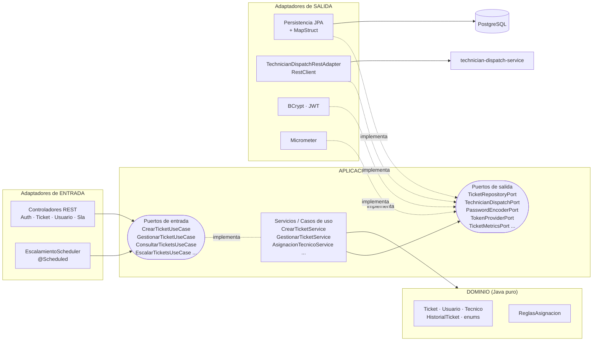
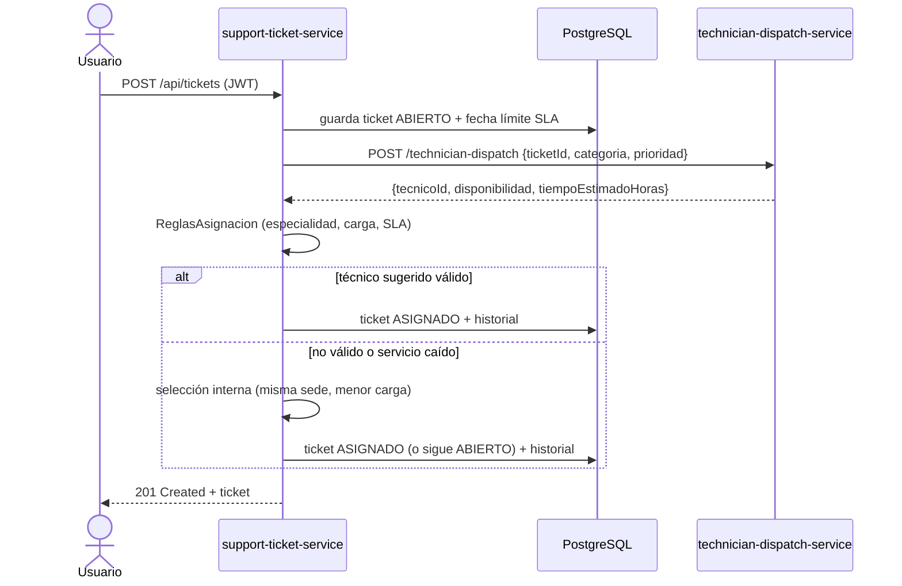
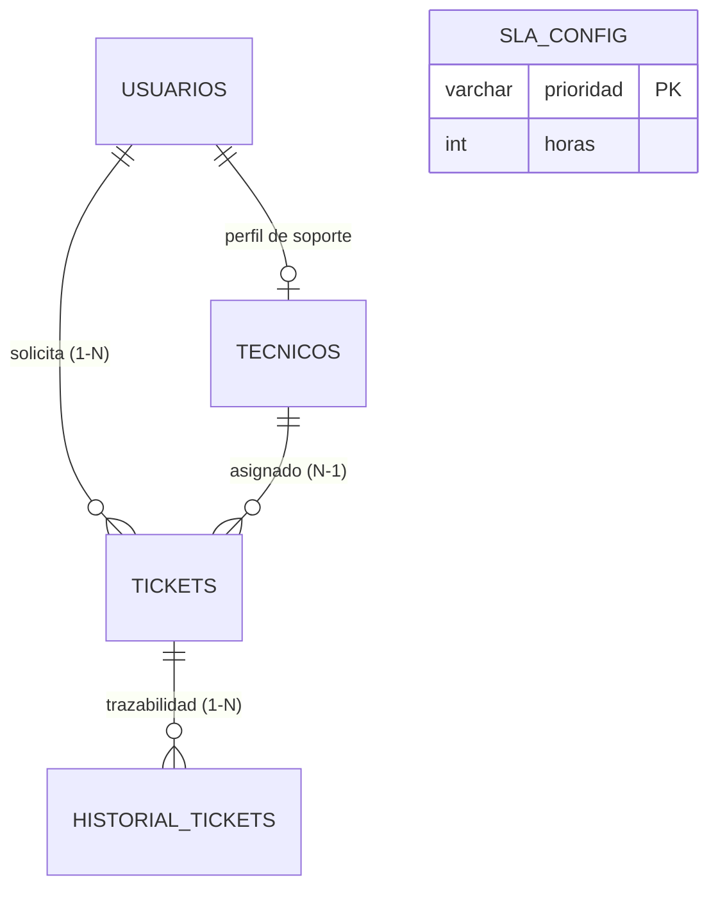
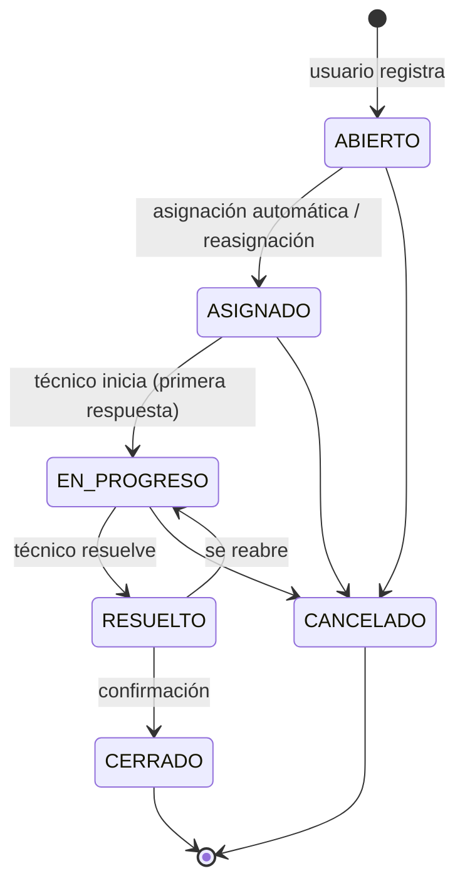

# HelpFlow — Sistema Integral de Gestión de Soporte TI

Prueba de desempeño – Módulo 6 (Java + Spring Boot).
Sistema compuesto por **dos microservicios** para registrar, priorizar, asignar, escalar y cerrar tickets de soporte tecnológico.

| Microservicio | Puerto | Qué hace |
|---|---|---|
| `support-ticket-service` | 8080 | Servicio central. Arquitectura hexagonal, JPA + PostgreSQL, Flyway, seguridad JWT, validaciones, ProblemDetail, métricas, pruebas. |
| `technician-dispatch-service` | 8081 | Servicio liviano (sin JPA ni seguridad) que sugiere un técnico y un tiempo estimado de forma determinista. |

Cada microservicio tiene su propio README con el detalle de sus carpetas, clases y conexiones:
[`support-ticket-service/README.md`](support-ticket-service/README.md) · [`technician-dispatch-service/README.md`](technician-dispatch-service/README.md)

---

## Contenido

1. [Tecnologías](#tecnologías)
2. [Estructura del repositorio](#estructura-del-repositorio)
3. [Arquitectura](#arquitectura)
4. [Cómo ejecutar](#cómo-ejecutar)
5. [Usuarios de prueba](#usuarios-de-prueba)
6. [Endpoints](#endpoints)
7. [Roles y control de acceso](#roles-y-control-de-acceso)
8. [Flujo de asignación](#flujo-de-asignación)
9. [Estados y transiciones](#estados-y-transiciones)
10. [Reglas de SLA y escalamiento](#reglas-de-sla-y-escalamiento)
11. [Errores (ProblemDetail)](#errores-problemdetail)
12. [Observabilidad](#observabilidad)
13. [Pruebas](#pruebas)
14. [Evidencias (capturas)](#evidencias-capturas)
15. [Notas y supuestos](#notas-y-supuestos)

---

## Tecnologías

Java 21 · Spring Boot 3.4 · Spring Web · Spring Data JPA (Hibernate) · PostgreSQL 16 · Flyway · Spring Security + JWT (JJWT 0.12) · Bean Validation · MapStruct · Lombok (solo en entidades JPA) · Actuator + Micrometer + Prometheus · Micrometer Tracing (traceId) · springdoc-openapi (Swagger) · JUnit 5 + Mockito + MockMvc + Testcontainers · Docker multi-stage + docker-compose.

---

## Estructura del repositorio

```
helpflow/
├── docker-compose.yml               Levanta db + los dos microservicios en una red común
├── README.md                        Este documento
├── postman/
│   └── HelpFlow.postman_collection.json   Colección de pruebas (44 peticiones, en orden)
├── docs/capturas/                   Evidencias (capturas de pantalla)
├── support-ticket-service/          Servicio central — arquitectura hexagonal
│   ├── README.md                    Detalle de carpetas, puertos/adaptadores y conexiones
│   ├── Dockerfile
│   ├── pom.xml
│   └── src/
│       ├── main/java/.../support/
│       │   ├── domain/              Reglas de negocio (Java puro)
│       │   ├── application/         Casos de uso + puertos (interfaces)
│       │   └── infrastructure/      REST, JPA, seguridad, métricas, configuración
│       ├── main/resources/          application.yml + migraciones Flyway
│       └── test/                    Pruebas unitarias e integración
└── technician-dispatch-service/     Servicio liviano de disponibilidad técnica
    ├── README.md
    ├── Dockerfile
    ├── pom.xml
    └── src/
        ├── main/java/.../dispatch/  controller · service · dto
        └── test/                    Pruebas
```

| Carpeta | Para qué sirve |
|---|---|
| `support-ticket-service/` | Usuarios, tickets, asignación, SLA, historial, seguridad JWT, errores y métricas. Habla con PostgreSQL y con el dispatch. |
| `technician-dispatch-service/` | Recibe `ticketId + categoría + prioridad` y devuelve técnico sugerido, disponibilidad y horas estimadas. |
| `postman/` | Colección para probar todo el flujo; guarda tokens e IDs automáticamente. |
| `docs/capturas/` | Imágenes de evidencia que se muestran en este README. |
| `docker-compose.yml` | Orquesta los tres contenedores (`db`, `support-ticket-service`, `technician-dispatch-service`). |

---

## Arquitectura

### Arquitectura hexagonal (support-ticket-service)



**Regla de oro:** las flechas de dependencia siempre apuntan hacia el centro. El dominio no conoce a nadie; la aplicación solo conoce al dominio y a sus propios puertos (interfaces); la infraestructura implementa esos puertos.

```
support-ticket-service/src/main/java/com/helpflow/support
├── domain/                      ← Java puro (sin Spring, sin JPA)
│   ├── model/                   Ticket, Usuario, Tecnico, HistorialTicket, Actor, enums
│   ├── service/                 ReglasAsignacion
│   └── exception/               excepciones de negocio
├── application/
│   ├── port/in/                 interfaces de casos de uso + comandos
│   ├── port/out/                interfaces que la aplicación necesita (repositorios, dispatch, JWT...)
│   └── service/                 implementación de los casos de uso
└── infrastructure/
    ├── adapter/in/rest/         controladores, DTOs, validadores, MapStruct, manejo global de errores
    ├── adapter/in/scheduler/    escalamiento automático
    ├── adapter/out/persistence/ entidades JPA, repositorios Spring Data, mappers, adaptadores
    ├── adapter/out/rest/        cliente HTTP hacia technician-dispatch-service
    ├── adapter/out/security/    BCrypt y JWT
    ├── adapter/out/metrics/     Micrometer
    └── config/                  Spring Security, filtro JWT, Swagger, beans, métricas
```

### Relación entre microservicios



### Modelo de datos



Migraciones Flyway: `V1__schema.sql` (usuarios, técnicos, tickets) · `V2__asignaciones_historial_sla.sql` (historial, sla_config, columnas de SLA) · `V3__datos_iniciales.sql` (admin, usuario demo y 10 técnicos).

---

## Cómo ejecutar

### Opción A — Todo con Docker (recomendada)

Requisitos: Docker Desktop.

```bash
docker compose up --build
```

| Qué | URL |
|---|---|
| API principal | http://localhost:8080 |
| Swagger UI | http://localhost:8080/swagger-ui.html |
| Health | http://localhost:8080/actuator/health |
| Dispatch | http://localhost:8081/technician-dispatch |

Para borrar todo (incluida la base de datos): `docker compose down -v`.

### Opción B — Local (IntelliJ / Maven)

Requisitos: JDK 21, Maven 3.9+, Docker (para la base de datos y las pruebas).

```bash
# 1. Solo la base de datos
docker compose up -d db

# 2. Microservicio de dispatch (otra terminal)
cd technician-dispatch-service
mvn spring-boot:run

# 3. Servicio principal (otra terminal)
cd support-ticket-service
mvn spring-boot:run
```

Variables de entorno opcionales del servicio principal: `DB_URL`, `DB_USER`, `DB_PASSWORD`, `DISPATCH_URL`, `JWT_SECRET` (mínimo 32 caracteres), `JWT_EXPIRATION_MS`, `ESCALAMIENTO_MS`.

---

## Usuarios de prueba

Creados por `V3__datos_iniciales.sql` (contraseñas guardadas con BCrypt):

| Correo | Contraseña | Rol |
|---|---|---|
| admin@helpflow.com | `Admin123*` | ROLE_ADMIN |
| usuario@helpflow.com | `Usuario123*` | ROLE_USUARIO |
| tec001@helpflow.com … tec010@helpflow.com | `Tecnico123*` | ROLE_TECNICO |

| Técnico | Especialidad | Sede |
|---|---|---|
| TEC-001 / TEC-002 | HARDWARE | BOGOTA / MEDELLIN |
| TEC-003 / TEC-004 | SOFTWARE | BOGOTA / BARRANQUILLA |
| TEC-005 / TEC-006 | RED | BOGOTA / MEDELLIN |
| TEC-007 / TEC-008 | ACCESOS | BARRANQUILLA / BOGOTA |
| TEC-009 / TEC-010 | OTRO | MEDELLIN / BARRANQUILLA |

Cada técnico admite máximo 5 tickets activos (configurable al registrarlo).

---

## Endpoints

### support-ticket-service (`:8080`)

| Método | Ruta | Rol | Descripción |
|---|---|---|---|
| POST | `/auth/register` | público | Registrar usuario solicitante |
| POST | `/auth/login` | público | Login → token JWT |
| GET | `/api/usuarios/me` | autenticado | Mi perfil |
| PUT | `/api/usuarios/me` | autenticado | Editar nombre, sede, área |
| PATCH | `/api/usuarios/{id}/estado` | ADMIN | Activar / inactivar usuario |
| POST | `/api/tecnicos` | ADMIN | Registrar técnico + perfil de soporte |
| GET | `/api/tecnicos` | ADMIN | Listar técnicos |
| POST | `/api/tickets` | USUARIO, ADMIN | Crear ticket (asignación automática) |
| GET | `/api/tickets` | autenticado | Usuario: los suyos · Técnico: asignados · Admin: todos |
| GET | `/api/tickets/{id}` | autenticado (con propiedad) | Ver ticket |
| GET | `/api/tickets/{id}/historial` | autenticado (con propiedad) | Trazabilidad |
| PATCH | `/api/tickets/{id}/estado` | TECNICO asignado, ADMIN | Cambiar estado con observación |
| PATCH | `/api/tickets/{id}/reasignar` | ADMIN | Reasignar técnico |
| POST | `/api/tickets/escalamientos` | ADMIN | Ejecutar ya el escalamiento por SLA |
| GET | `/api/sla` | ADMIN | Ver horas de SLA |
| PUT | `/api/sla/{prioridad}` | ADMIN | Cambiar horas de SLA |
| GET | `/actuator/health`, `/info`, `/metrics`, `/prometheus` | público | Observabilidad |

Ejemplo — crear ticket:

```http
POST /api/tickets
Authorization: Bearer <token>
Content-Type: application/json

{
  "titulo": "Sin conexión a internet",
  "descripcion": "Todo el piso 3 se quedó sin red desde las 8 am",
  "categoria": "RED",
  "prioridad": "ALTA",
  "sede": "BOGOTA",
  "activoAfectado": "Switch piso 3"
}
```

Valores permitidos: `categoria` = HARDWARE, SOFTWARE, RED, ACCESOS, OTRO · `prioridad` = BAJA, MEDIA, ALTA, CRITICA · `estado` = ABIERTO, ASIGNADO, EN_PROGRESO, RESUELTO, CERRADO, CANCELADO.

### technician-dispatch-service (`:8081`)

```http
POST /technician-dispatch
{ "ticketId": 125, "categoria": "RED", "prioridad": "ALTA" }

→ { "ticketId": 125, "tecnicoId": "TEC-006", "disponibilidad": "MEDIA", "tiempoEstimadoHoras": 6 }
```

Determinista: `seed = Objects.hash(ticketId, categoria, prioridad)` → `new Random(seed)` elige un técnico de la especialidad y un tiempo según la prioridad. Clasificación: 0–2 h ALTA · 3–8 h MEDIA · >8 h BAJA.

---

## Roles y control de acceso

El acceso se controla en dos niveles:

1. **Por rol** con `@PreAuthorize` en los controladores (ej.: un técnico no puede crear tickets).
2. **Por propiedad** dentro de los casos de uso (`Ticket.puedeSerConsultadoPor` / `puedeSerGestionadoPor`).

| Rol | Puede |
|---|---|
| ROLE_USUARIO | Crear tickets y consultar **solo los suyos** (y su historial). Editar su perfil. |
| ROLE_TECNICO | Consultar y gestionar (cambiar estado) **solo los tickets asignados a él**. |
| ROLE_ADMIN | Todo: ver todos los tickets, cambiar estados, reasignar, escalar, configurar SLA, registrar técnicos, activar/inactivar usuarios. |

---

## Flujo de asignación

1. El usuario registra el ticket → queda **ABIERTO**, con `fechaLimiteSla = fechaCreacion + horasSLA(prioridad)`.
2. Se consulta `technician-dispatch-service` a través del puerto `TechnicianDispatchPort` (adaptador REST).
3. El servicio responde técnico sugerido, disponibilidad y tiempo estimado.
4. `ReglasAsignacion` valida al sugerido:
   - técnico **ACTIVO**;
   - **compatibilidad** categoría–especialidad (los tickets `OTRO` los puede atender cualquiera);
   - **carga máxima** de tickets activos (ABIERTO/ASIGNADO/EN_PROGRESO);
   - **cumplimiento del SLA**: `ahora + tiempoEstimado ≤ fechaLimiteSla`.
5. Si el sugerido no cumple (o el servicio está caído), se hace una **selección interna**: técnicos activos que cumplan las reglas, prefiriendo la **misma sede** del ticket y la **menor carga**.
6. Si hay técnico → **ASIGNADO**; si no → sigue **ABIERTO**. Todo queda en el historial con el motivo.
7. Creación, asignación e historial ocurren dentro de **una sola transacción** (`@Transactional`).

---

## Estados y transiciones



- Toda transición exige una **observación**; para RESUELTO, CERRADO y CANCELADO debe tener al menos 10 caracteres (validación cruzada `@ObservacionSuficiente`).
- Una transición no permitida responde **409** (`transicion-invalida`).
- A ASIGNADO solo se llega por asignación/reasignación, no por cambio de estado manual.

---

## Reglas de SLA y escalamiento

| Prioridad | Horas por defecto |
|---|---|
| CRITICA | 4 |
| ALTA | 8 |
| MEDIA | 24 |
| BAJA | 72 |

- El ADMIN las cambia con `PUT /api/sla/{prioridad}`. Validación cruzada: CRITICA ≤ ALTA ≤ MEDIA ≤ BAJA (si no, 422).
- Un ticket está **vencido** si está activo y `ahora > fechaLimiteSla` (campo `vencido` en la respuesta y métrica `helpflow.tickets.vencidos`).
- **Escalamiento automático** (cada minuto, `@Scheduled`): si a un ticket activo le queda **25 % o menos** de su tiempo de SLA, sube **un nivel de prioridad** (una sola vez), se marca `escalado = true`, se registra en el historial y, si no tenía técnico, se intenta asignar uno. También se puede disparar con `POST /api/tickets/escalamientos`.

---

## Errores (ProblemDetail)

Todos los errores siguen RFC 7807 y se generan en `GlobalExceptionHandler` (`@RestControllerAdvice`) o en `SecurityProblemHandlers` (401/403 del filtro de seguridad):

```json
{
  "type": "https://helpflow.com/errores/validacion",
  "title": "Datos inválidos",
  "status": 400,
  "detail": "La petición tiene 1 error(es) de validación",
  "instance": "/auth/register",
  "timestamp": "2026-11-07T14:32:10.123Z",
  "traceId": "6730c9a2f1b44e1d8a7f3c21b9e04d55",
  "errores": [ { "campo": "correo", "mensaje": "debe ser un correo corporativo @helpflow.com" } ]
}
```

| Código | Cuándo |
|---|---|
| 400 | Bean Validation, JSON inválido, validaciones cruzadas |
| 401 | Sin token, token inválido/vencido, credenciales incorrectas |
| 403 | Rol sin permiso o ticket que no le pertenece |
| 404 | Ticket, usuario o técnico inexistente |
| 409 | Duplicados (documento/correo/código), transición inválida, violación de integridad JPA |
| 422 | Regla de negocio (usuario inactivo, técnico no habilitado, SLA incoherente) |

El `traceId` también aparece en los logs, así un error del cliente se encuentra rápido en el log.

---

## Observabilidad

- `/actuator/health`, `/actuator/info`, `/actuator/metrics`, `/actuator/prometheus`.
- **Logging estructurado** en JSON (formato ECS de Spring Boot 3.4), con `traceId` y `spanId` en cada línea.

| Métrica | Tipo | Significado |
|---|---|---|
| `helpflow.tickets.creados{categoria,prioridad}` | Counter | Tickets creados por categoría y prioridad |
| `helpflow.tickets.primera.respuesta` | Timer | Tiempo creación → EN_PROGRESO (promedio = TOTAL_TIME / COUNT) |
| `helpflow.tickets.resolucion` | Timer | Tiempo creación → RESUELTO |
| `helpflow.tickets.vencidos` | Gauge | Tickets activos con SLA vencido (consulta la BD) |
| `helpflow.tickets.escalados{prioridad}` | Counter | Tickets escalados |
| `helpflow.auth.fallos` | Counter | Login fallido, token ausente o inválido |
| `helpflow.accesos.denegados` | Counter | Respuestas 403 |

Ejemplo: `GET /actuator/metrics/helpflow.tickets.creados?tag=categoria:RED`.

---

## Pruebas

```bash
cd support-ticket-service
mvn clean verify        # requiere Docker encendido (Testcontainers)

cd ../technician-dispatch-service
mvn clean verify
```

| Tipo | Clases | Qué prueba |
|---|---|---|
| Unitarias (dominio) | `TicketTest`, `ReglasAsignacionTest` | Máquina de estados, SLA, escalamiento, reglas de asignación |
| Unitarias (casos de uso, JUnit + Mockito) | `CrearTicketServiceTest`, `GestionarTicketServiceTest` | Casos de uso con **mock del `TechnicianDispatchPort`** y de los repositorios |
| Integración (Spring Boot Test + MockMvc + Testcontainers) | `AuthIntegrationTest`, `TicketIntegrationTest` | Registro/login JWT, ProblemDetail, CRUD, asignación, transiciones, restricciones por propietario/técnico, SLA, métricas — contra PostgreSQL real en contenedor |
| Dispatch | `DispatchServiceTest`, `DispatchControllerTest` | Determinismo y endpoint |

Colección Postman: [`postman/HelpFlow.postman_collection.json`](postman/HelpFlow.postman_collection.json). Ejecuta las carpetas en orden (1 → 6); los tokens y el id del ticket se guardan solos.

---

## Evidencias (capturas)

Las imágenes están en [`docs/capturas/`](docs/capturas/). Fueron tomadas con el sistema levantado con `docker compose up` (API publicada en el puerto 8082 del equipo).

### Swagger UI — vista general de la API

Documentación generada automáticamente por springdoc-openapi a partir de los controladores. Se ven los cuatro grupos de endpoints (Autenticación, Usuarios y técnicos, Configuración de SLA y Tickets) y el botón **Authorize** para enviar el token JWT.


### Login como usuario — `POST /auth/login` (200)

`usuario@helpflow.com` obtiene un token JWT con rol `ROLE_USUARIO`.


### Login como administrador — `POST /auth/login` (200)

`admin@helpflow.com` obtiene un token JWT con rol `ROLE_ADMIN`.


### Login como técnico — `POST /auth/login` (200)

`tec010@helpflow.com` obtiene un token JWT con rol `ROLE_TECNICO`.


---

## Notas y supuestos

- El enunciado incluye por error algunas líneas de otra prueba (“salario”, “fecha de afiliación”, “afiliado ACTIVO para solicitar crédito”). No aplican al dominio de soporte TI y no se implementaron.
- Correo corporativo = dominio `@helpflow.com`.
- Los técnicos son usuarios con `ROLE_TECNICO` más un perfil de soporte (código, especialidad, sede, carga máxima).
- Las prioridades se escriben sin tilde (`CRITICA`) para evitar problemas en JSON/URLs.
- Si `technician-dispatch-service` no responde, el ticket **no falla**: se usa la selección interna.
- Gateway y config-server (opcionales) no se incluyeron.

---

## Solución de problemas

| Síntoma | Causa / solución |
|---|---|
| Lombok o MapStruct fallan al compilar en IntelliJ | Usa **JDK 21** en *Project Structure* y activa *Enable annotation processing* (Settings → Build → Compiler → Annotation Processors). |
| `Could not find a valid Docker environment` al correr `mvn verify` | Docker Desktop debe estar abierto. Las pruebas de integración usan Testcontainers. Para compilar sin ellas: `mvn package -DskipTests`. |
| `client version 1.32 is too old` | Ya está resuelto con `src/test/resources/docker-java.properties` (`api.version=1.44`). |
| `port is already allocated` / `address already in use` (8080, 8081 o 5432) | Otro programa usa ese puerto (a menudo el mismo servicio corriendo desde IntelliJ). Ciérralo, o cambia el puerto del host: `DISPATCH_PORT=9081 docker compose up --build` (también `API_PORT` y `DB_PORT`). En Windows PowerShell: `$env:DISPATCH_PORT=9081; docker compose up --build`. |
| `Connection refused` a `localhost:5432` | Levanta primero la base: `docker compose up -d db`. |
| El ticket queda `ABIERTO` | No había técnico válido (especialidad, carga o SLA). Revisa `GET /api/tickets/{id}/historial`: ahí está el motivo. |
